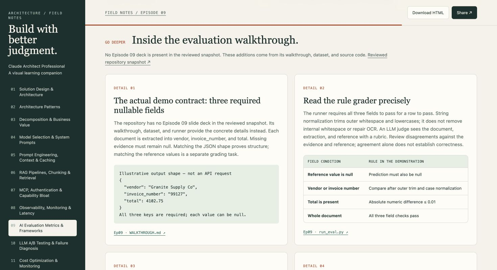

# Claude Architect Professional — Visual Learning Pages

An independent learning companion to Peace Of Code’s Claude Architect Professional course. Each of the eleven episodes has a separate, self-contained HTML page with an interactive concept map, decision table, process flow, worked example, and application checklist.

The collection includes 55 core takeaways and 39 additional source-linked detail cards. Episode 11 also includes an editable cost calculator using illustrative rates.

## Open the course

[Download the complete HTML ZIP](claude-architect-pro-learning-pages.zip), extract it, and open `index.html` in a browser. Keep all twelve HTML files together for episode navigation. You can also clone this repository and open `index.html` directly.

Notes, diagrams, and the calculator work offline. Video and repository source links require internet. Each page offers Download HTML and Share controls; browser support determines whether sharing uses a link, a file, or a downloaded file with a suggested caption.



## Episodes

| Episode | Topic |
|---|---|
| 01 | Solution design and architecture |
| 02 | Architecture patterns |
| 03 | Decomposition and business value |
| 04 | Model selection and system prompts |
| 05 | Prompt engineering, context, and caching |
| 06 | RAG pipelines, chunking, and retrieval |
| 07 | MCP, authentication, and capability scope |
| 08 | Observability, monitoring, and latency |
| 09 | Evaluation metrics and frameworks |
| 10 | A/B testing and failure diagnosis |
| 11 | Cost optimization and monitoring |

## Sources and coverage

- [Peace Of Code’s supplied YouTube playlist](https://youtube.com/playlist?list=PLPsBalbS2-zs). The pages synthesize available auto-generated transcripts for Episodes 01–11; the introductory video is excluded.
- [Companion slide decks and code by aakash1999](https://github.com/aakash1999/claude-certified-architect-professional/tree/f710b2975e297b12f839dda071231448523e43a3), pinned to commit `f710b2975e297b12f839dda071231448523e43a3`. The supplement reviews 146 slides across nine decks covering Episodes 01–08 and 10, plus Episode 06/09 companion files.

Episode 09 has walkthrough, dataset, and runner files but no deck in that snapshot. Episode 11 has no folder, so its additional detail cards explicitly connect earlier material. Every detail card links to its supporting file, with slide numbers where applicable. Original decks and full transcripts are not redistributed in this repository.

These are selected, original learning notes, not exhaustive video transcriptions or official certification guidance. Scenario numbers and calculator rates are illustrative. Model/API behavior, pricing, protocol details, and exam requirements need current official verification. Companion scripts were inspected, not run against provider APIs. This project is not affiliated with or endorsed by Anthropic.

## Rebuild

Requires Python 3; no third-party packages or frontend build step.

```sh
python3 build.py
```

Edit `course-data.json` for the core lessons and `slide-details.json` for the sourced additions. The generator rebuilds the twelve HTML files and ZIP, and checks episode coverage, unique IDs, local navigation, source references, diagram edges, and illustrative cost arithmetic.

The public repository contains only the learning-page artifact and its generator, data, and previews. It does not include the personal knowledge vault or its Git history.
